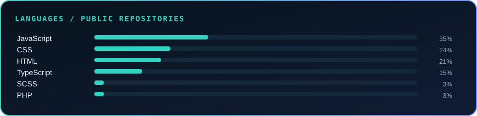
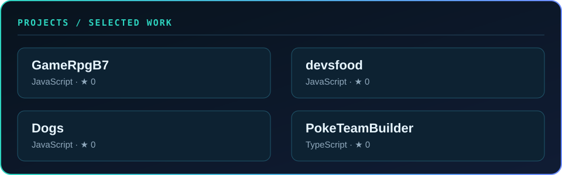

<h1 align="center">Hey  I'm Luiz Henrique Martins</h1>

<strong>Frontend or full-stack engineer</strong> · the public internet

<h2>📌 About Me</h2>
<blockquote>Building useful things and sharing the work in public.</blockquote>

Small teams, ambitious ideas, and useful collaborations.

<strong>Current focus:</strong> TypeScript

<h2>Profile snapshot</h2>

─────── ◇ ───────

## Tools of the trade

<code>lzhenry666@github:~$ toolbox --list</code>

─────── ◇ ───────

<h2>Featured reel</h2>

─────── ◇ ───────

<h2>Contribution trail</h2>

─────── ◇ ───────

THE NEXT SCENE

<h2>Keep the story moving</h2>

I enjoy working with people who care about the details, share the context, and ship something useful.

   &nbsp;·&nbsp;
   &nbsp;·&nbsp;
   &nbsp;·&nbsp;
   &nbsp;·&nbsp;
  

